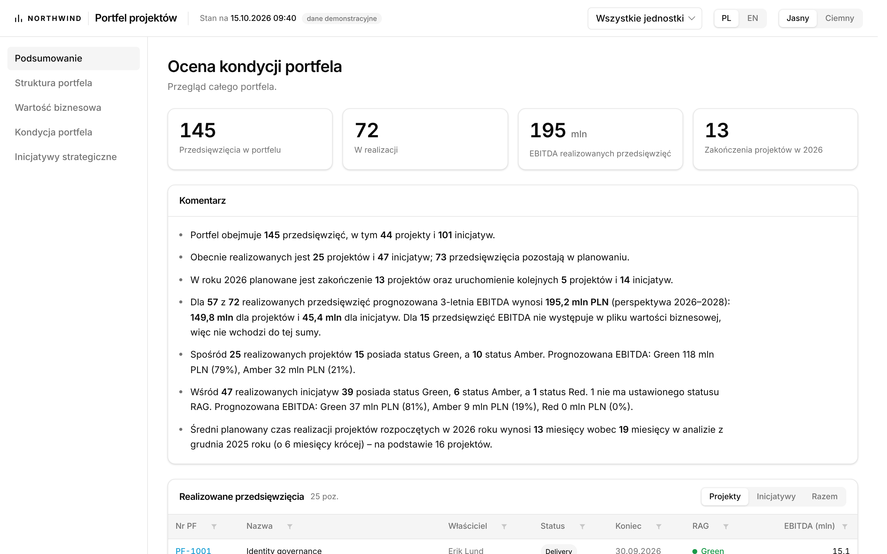
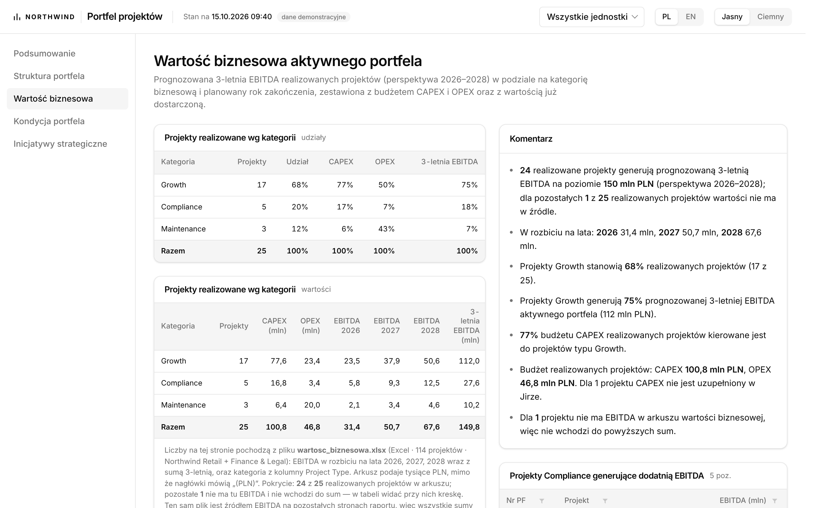
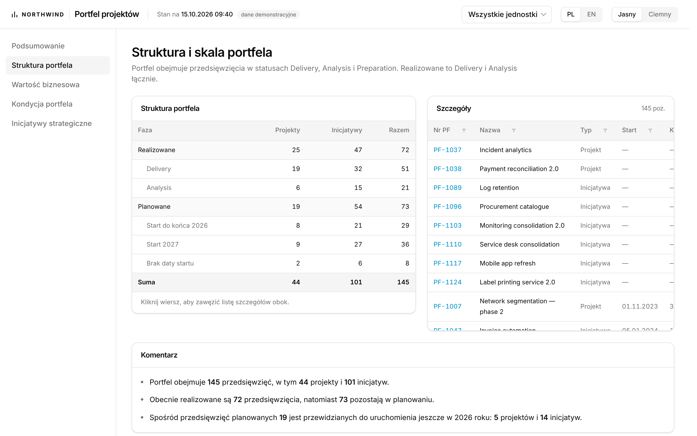
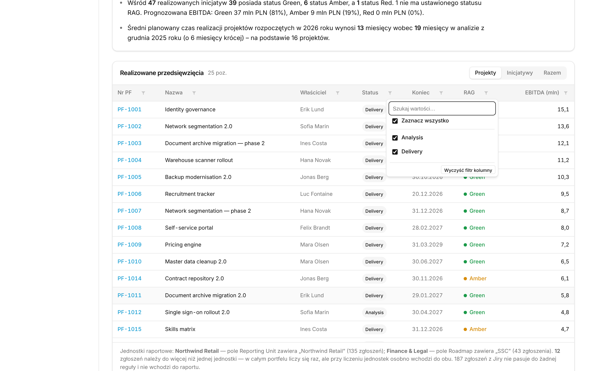
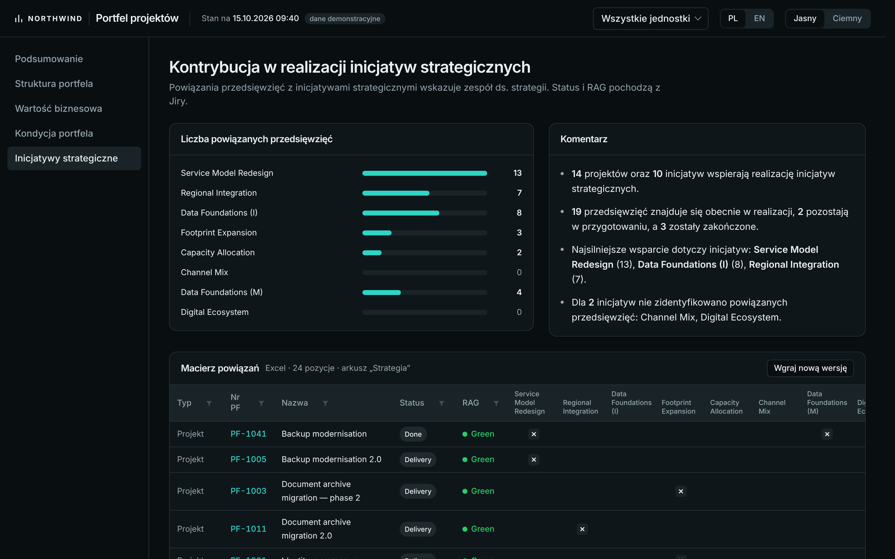
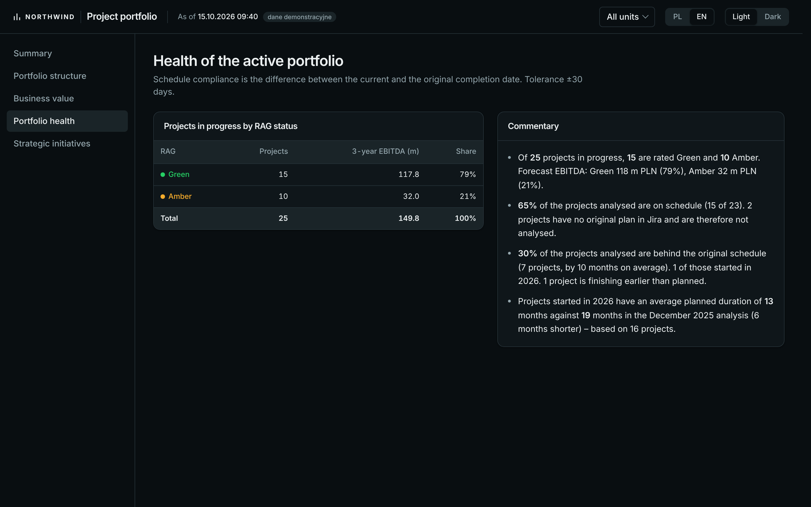

# Portfolio dashboard

Project and initiative portfolio health, read from Jira Cloud. It replaces a
wiki page that somebody had to update by hand every month: the same figures,
the same definitions, now read straight from the issue tracker and recomputed
on every load. The definitions were carried over from an earlier Power BI
model, so the two agreed line for line while both were running.

> **About this copy.** This is a public, anonymised copy of an application that
> runs internally somewhere else, behind single sign-on and a TLS certificate.
> Every name in it is invented — the company, the business units, the strategic
> initiatives, the projects, the people — and the whole demo dataset is
> synthetic. No figure here describes any real organisation. The code is what
> runs; only the data and the names do not.

Plain HTML, CSS and JavaScript. No framework, no build step, no package manager,
no external fonts or CDNs — the page renders with no network access beyond the
data source itself. This is deliberate: the application has to run on locked-down
corporate machines and survive being handed to whoever maintains it next.

Two languages, Polish and English, switched in the top bar. All display text
lives in `public/js/i18n.js` and nowhere else.

## Screenshots

All of it on the synthetic dataset that ships with the repository; the interface
is shown in Polish, which is what it was built for, with English one click away.

**Summary** — the four headline figures and the commentary the report writes
about itself. Every sentence is generated from the data, including the ones that
say what is missing: here, 15 of 72 items in progress carry no EBITDA, so they
stay out of the total and the text says so.



**Business value** — EBITDA split by year and by business category, next to the
CAPEX and OPEX budget. The footnote under the table names the workbook the
figures came from, how many projects it covers and what happens to the rest.



**Portfolio structure** — the phase matrix on the left drives the detail list on
the right: click a row and the list narrows to it.



**Every table filters and sorts.** Values come from the column itself, the count
of hidden rows is stated next to the heading, and the state survives switching
the unit filter or the Projects / Initiatives / Total toggle. At the bottom of
the shot: the control line that says which rule caught how many issues, how many
belong to two units and how many were dropped.



**Strategic initiatives, dark theme** — contribution of portfolio items to each
initiative, read from a workbook another team maintains and uploads through the
button in the header.



**Portfolio health, English, dark theme** — schedule compliance against the
original baseline dates.



---

## The parts worth a look

- **Rule-based reporting units** (`config.js` → `units`, `data.js` → `unitsOf`).
  A unit is not a field value but a rule: one unit comes from a single-select
  field, another from a multi-select containing a particular tag. An issue can
  belong to two units at once, is counted once in the portfolio total, and the
  report prints a control line saying how many issues each rule caught, how many
  overlap and how many were dropped — because a filter that silently drops rows
  is how a dashboard starts lying.
- **A measure layer** (`measures.js`) that mirrors the DAX model this replaced:
  small composable functions over rows, `M.ebitda(M.proj(M.running(M.portfolio(F()))))`,
  so a page is a sentence rather than a query.
- **Two languages without a template engine** (`i18n.js`). Sentences with
  numbers are *functions*, not strings with placeholders, because Polish picks
  one of three plural forms and declines the verb with it while English needs
  two. Each language writes its own grammar and takes the raw numbers.
- **An .xlsx/.xlsm reader with no dependencies, written twice** — in JavaScript
  (`tools/xlsx.js`) and in PowerShell 5.1 (`tools/serve.ps1`), because the
  target machine had neither Excel automation nor a package manager. It finds
  the key column by content rather than by caption, since the real workbook has
  a merged two-row header that moves.
- **Upload that cannot corrupt what it replaces** (`POST /api/reference`). The
  workbook is validated, written to a temporary file and *parsed* before
  anything is replaced; a rejected upload leaves the previous data in place and
  says why. The report then shows when the file arrived and from whom, and turns
  the line amber once it is older than a configured number of days.
- **A deployment runbook** (*Deployment*) rather than a `docker run` line: IIS
  in front for TLS and Windows Authentication, the app on loopback, data outside
  the folder that gets replaced on release, and a checklist where every failed
  item names the step that caused it.

## How this was built

Written with Claude (Anthropic) as a pair programmer: most of the code in this
repository was produced in that conversation. The business logic, the field
mapping, the data definitions, the verification against the numbers the previous
report published, and every decision about what the dashboard should assert are
mine — several of them corrected the code, including the discovery that the
EBITDA field covers five years rather than three and that the handover workbook
holds thousands rather than units.

---

## Quick start

```bash
node tools/serve.js 8000          # anywhere Node is installed
```
```powershell
powershell -ExecutionPolicy Bypass -File tools\serve.ps1
```
```bash
node tools/smoke.js 8000          # optional: does every page still render?
```

Then open <http://localhost:8000> and press **Dane demonstracyjne** (*Demo
data*) on the sign-in screen: the whole report fills with the synthetic dataset,
no Jira and no workbooks needed. That is the fastest way to see what this is.

The two servers are equivalent; the PowerShell one exists because it runs on a
locked-down Windows machine with nothing installed, which is where this had to
work. Stop either with Ctrl+C.

Before the report shows **live** figures you need two things:

1. **A Jira API token** — <https://id.atlassian.com/manage-profile/security/api-tokens>.
   The sign-in screen asks for your work e-mail and that token.
2. **The two workbooks in `dane\`** (see *Data sources*). Without them the report
   still opens, says on screen what is missing, and falls back to Jira figures.

---

## Running it

### Development

A browser refuses to read neighbouring files when a page is opened straight from
disk, so the app needs a server. Two ways, in order of how little has to be
installed.

**PowerShell — needs nothing at all.** Present on every Windows machine, no
administrator rights required. This is also the only option that serves the
`/api` endpoints, so it is the one to use:

```powershell
powershell -ExecutionPolicy Bypass -File tools\serve.ps1
powershell -ExecutionPolicy Bypass -File tools\serve.ps1 -Port 8080
```

**Node — if it is already on the machine** (`node -v` to check). No
`npm install`; the script uses only the standard library. Functionally
identical to `serve.ps1`; the two are kept in step deliberately so that the
awkward parts (the .xlsx reader) can be tested where testing is easy:

```bash
node tools/serve.js 8000
```

> `serve.ps1` loads once at start-up. **After editing it, stop the server with
> Ctrl+C and start it again** — refreshing the browser will not pick up the
> change. Everything else (HTML, CSS, JS, the workbooks) is read per request,
> so a refresh is enough.

### No server at all

For a machine where nothing can be run:

```bash
node tools/build-single-file.js
```

This writes `dist/portfolio-dashboard.html` with the stylesheet, every script and
both data files inlined. It opens by double-clicking and behaves identically —
only live Jira and the `/api` endpoints stay unavailable, as they are from any
file-based page. Rebuild after every change to `public/`; never edit the output.

### Production

See *Deployment* below, which describes the one target shape: Node as a Windows
service behind IIS. **`serve.ps1` is a development server and must not be used
for anything else** — it has no TLS, no request limits, no logging and no
process supervision.

It also cannot serve anyone but the machine it runs on. Both development
servers bind to loopback on purpose:

```powershell
# tools/serve.ps1
$listener = New-Object System.Net.Sockets.TcpListener([System.Net.IPAddress]::Loopback, $Port)
```
```js
// tools/serve.js
.listen(PORT, '127.0.0.1', ...)
```

In the deployed shape that binding stays exactly as it is: IIS is the part that
listens on the network, and it proxies to Node over loopback. Pointing Node at a
network address and skipping IIS is the one shortcut that must not be taken — it
publishes an unauthenticated, unencrypted server that proxies Jira and accepts
matrix uploads.

---

## Layout

```
public/                     everything the browser loads
├── index.html              markup only; every figure is written in by render.js
├── css/
│   └── style.css           themes, layout, tables, charts
├── js/                     loaded in this order — the order matters
│   ├── config.js           ① settings: field IDs, units, statuses, thresholds
│   ├── i18n.js             ② every user-visible string, Polish and English
│   ├── utils.js            ③ formatting, Polish grammar, DOM helpers
│   ├── data.js             ④ raw issues → model rows
│   ├── measures.js         ⑤ model rows → figures
│   ├── api.js              ⑥ data sources: demo, pasted, live, workbooks
│   ├── tablefilter.js      ⑦ per-column filtering and sorting
│   ├── render.js           ⑧ model + measures → HTML, one function per page
│   └── app.js              ⑨ shell, sign-in, language, theme, boot
└── data/
    ├── demo-issues.json    demo dataset for presentations and development
    └── reference.json      fallback strategic matrix and benchmarks

dane/                       workbooks the SERVER reads — not in source control
├── wartosc_biznesowa.xlsx  per-year EBITDA and project category
├── inicjatywy.xlsm         strategic-initiative matrix, replaced by upload
└── inicjatywy.meta.json    when it was uploaded and by whom

tools/
├── serve.ps1               development server + Jira proxy + .xlsx reader
├── serve.js                the same in Node, used to test the .xlsx reader
├── xlsx.js                 the .xlsx reader on its own, Node only
└── build-single-file.js    bundles everything into dist/ for offline use

server/                     notes for a production backend — see Deployment
```

The scripts are plain `<script>` tags rather than ES modules, so the app runs on
the simplest possible host and each file's globals are visible to the next. The
trade-off is that **load order matters**; it is documented at the top of
`index.html` and must be kept.

### `dane/` is not served and not committed

Everything under `public/` is reachable over HTTP. The workbooks hold EBITDA per
project, so they live outside it: the server reads them from disk and hands out
only the computed figures. `.gitignore` keeps the folder out of source control.

The two workbooks have different lifecycles and `dane/` suits only one of them:

| File | Who changes it | Where it belongs |
|---|---|---|
| `wartosc_biznesowa.xlsx` | nobody — a one-off handover, replaced once the data team publishes its table | `dane/`, next to the application |
| `inicjatywy.xlsm` | the strategy team, continuously | arrives by upload through the report and lands in `dane/`; the folder therefore has to be **writable** by the server — see *The strategic matrix* |
| `inicjatywy.meta.json` | the server, on every upload | `dane/`; holds only the timestamp and the uploader's e-mail |

### Why the layers are separate

`data.js` and `measures.js` mirror the two halves of the old Power BI model — the
Power Query transform and the DAX measures. Keeping that split means a question
like "why is this project counted as delayed?" has exactly one place to look, and
the figures stay comparable with the old report.

**`render.js` never computes anything and never contains a sentence.** If you
find arithmetic there it belongs in `measures.js`; if you find display text it
belongs in `i18n.js`.

---

## Data flow

```
   sources (api.js)                       workbooks (server, via /api)
   demo | pasted | live Jira              valuation | strategic matrix
        │                                        │
        └───────────────┬────────────────────────┘
                        ↓
                    start()          app.js — installs the dataset
                        ↓
                  buildModel()       data.js — derived columns, unit membership,
                        ↓                      workbook join; one row per issue
                   STATE.rows
                        ↓
                   renderAll()       render.js — redraws all five pages
```

Every user action that changes what is shown ends in `renderAll()`. There are no
partial updates: with a few hundred rows a full redraw is instant, and it removes
a whole class of stale-view bugs.

The reporting-unit filter is applied in one place, `F()` in `measures.js`. A page
that starts from `F()` responds to the filter automatically.

---

## Reporting units

A unit is not always a field value. `CFG.units` holds one rule per unit:

```js
units: [
  { name: 'Northwind Retail',  field: 'reportingUnit', values: ['Northwind Retail'] },
  { name: 'Finance & Legal', field: 'roadmap',       values: ['SSC'] },
],
```

Northwind Retail comes from the Reporting Unit field; Finance & Legal is
recognised by the Roadmap field containing `SSC`, because those projects carry
something else in Reporting Unit entirely. Adding a unit is one entry here, not
a code change.

**An issue can belong to two units at once.** It is then counted once across the
whole portfolio but appears under each unit separately, so the units will sum to
more than the total. The control line under the summary table states how many
issues this affects. Set `exclusive: true` on a rule to make it claim its issues
outright instead.

Issues matching no rule do not enter the report at all, and the same control line
says how many were dropped. That line is the first thing to read when a unit
looks empty: it names the field, the values and the counts.

---

## Data sources

### Jira

Live data goes through the server, never straight from the browser — see *The
CORS constraint* below. `CFG.jql` defines the scope; field IDs are in
`CFG.fields` and are the only place an ID is written down.

### The business-value workbook — `dane/wartosc_biznesowa.xlsx`

Carries two things Jira does not hold: **EBITDA split by year** with its
three-year total, and the **Growth / Compliance / Maintenance** classification.
Expected columns, located by what their headers say rather than by position:

| Issue Type | Key | Summary | Status | EBITDA w 2026 (PLN) | …2027 | …2028 | 3-letnia EBITDA | Project Type |
|---|---|---|---|---|---|---|---|---|

Every sheet is read and each row remembers which sheet it came from; the handover
file has one sheet per reporting unit.

Two things worth knowing, both verified against the data:

- The columns said "(PLN)" but held **thousands**. Read literally, the whole
  portfolio came out worth a couple of hundred thousand zloty; read as
  thousands, the total matched what the previous report published.
  `CFG.valuation.divisor` is 1000 for this reason, and it is the first thing to
  re-check against your own file.
- The three-year total is read from **its own column**, not summed from the
  years: the workbook rounds each year, so the parts do not always add up to the
  figure it publishes, and the published figure is the one people quote.

Where an issue is absent from the workbook the report shows a dash rather than
the Jira figure, so that two forecast horizons never land in one total. The
control line under the category tables states the coverage.

This is temporary. When the data team publishes its table, only the source
changes — the definitions stay.

### The strategic matrix — `inicjatywy.xlsm`

**This one is not an application file.** The strategy team maintains it and edits
it continuously, so the dashboard treats it as incoming data, not as source code.

It must never go into source control. Not for secrecy — because a business user
will not make a commit to add a row, every edit would become a change to the code
repository, and two people editing at once produce a merge conflict in a binary
file that cannot be resolved.

#### How it gets in: uploaded through the dashboard

The matrix is **uploaded through the report itself**. On *Strategic initiatives*
there is an **Upload a new version** button; it sends the file to
`POST /api/reference`, which validates it, replaces `dane/inicjatywy.xlsm` and
records who sent it and when. Nobody needs a server share, a sync client or
access to the deployment.

The server never trusts the upload:

1. the body must be non-empty and within `$uploadMaxBytes` (25 MB by default);
2. it must start with the ZIP signature `PK\x03\x04` — `.xlsx`/`.xlsm` are ZIP
   archives, so a renamed `.xls` or a PDF is rejected here;
3. it is written to a temporary file and **parsed first**;
4. only a workbook that parses replaces the current one.

That order is the point: **a bad upload leaves the previous matrix in place.** The
user gets the reason on screen (`There is no "Strategia" sheet. Available: …`) and
the report keeps showing the last good data instead of going blank.

Each upload writes `dane/inicjatywy.meta.json` with the timestamp and the
uploader's e-mail, taken from `X-Uploaded-By`. The report prints it under the
matrix — `Excel · 24 rows · sheet "Strategia" · uploaded 29.10.2026 by …` — and
turns the line amber once the file is older than
`CFG.reference.staleAfterDays` (45). An old matrix looks exactly like a current
one, so the dashboard says how old it is rather than leaving it to be noticed.

Set `$uploadAllowed = $false` (`UPLOAD.allowed` in `serve.js`) to switch uploading
off; `GET /api/reference` then answers `canUpload: false` and the button does not
appear. When the server cannot be reached at all the button stays visible on
purpose — that is the moment somebody needs to send a new file — and the attempt
fails with a clear message.

> Who may upload is **not** settled by the dashboard. Anyone who can open the
> report can replace the matrix. Behind Windows Authentication that is the AD
> group with access to the site, which is the intended control; until then, treat
> it as open to every reader. Step 4 of *Deployment* has the `web.config` block
> that narrows uploading to its own AD group.

Lookup order for reading: `dane/` first, then `$referenceFile`. The uploaded copy
therefore wins over any configured path, and replacing `serve.ps1` with a newer
version never wipes a production setting. A stale copy left in `dane/` is no
longer a silent trap — the upload date is on screen.

`$referenceFile` (a full path, normally UNC: `\\server\dept\inicjatywy.xlsm`)
remains available for a deployment that would rather read from a share than
accept uploads. Give the IIS app pool identity read access to it. Do not sync
OneDrive on a server under a service account — it is unreliable and drifts
without saying so — and do not expose the workbook through an "anyone with the
link" URL: it carries EBITDA and the strategy map.

#### Considered and rejected: SharePoint through Microsoft Graph

Reading the file in place from the team library (Entra ID app registration, Graph
application permission `Sites.Selected`, the file addressed by driveItem ID) was
specified and turned down: it needs IT, an app registration, a certificate and an
administrator's site grant before the first row can be read, which is too much
apparatus for a workbook that changes a few times a month.

It stays cheap to revisit. The reader in `tools/xlsx.js` accepts a **path or a
buffer**, and `/api/reference` returns the same JSON whatever the source, so
swapping in another source touches the server only — **the front end needs no
change at all.**

#### How it is read

The key column is found **by content** (the column holding the most cells shaped
like `PF-1234`), never by a caption: the workbook has a merged two-row header, a
counts row, and a macro that appends rows to two separate blocks, so every row and
column position shifts over time.

Every header column not listed in `$referenceSkip` counts as a strategic
initiative, and any non-empty cell under it is a link. Rows whose number is still
a placeholder are shown separately rather than dropped.

Both workbooks are accepted as `.xlsx` or `.xlsm` — the same format inside.

### Demo data

`public/data/demo-issues.json` — 353 issues, and in this public copy it is the
only dataset there is. Press *Dane demonstracyjne* on the sign-in screen and the
whole report fills: no Jira, no workbooks, no network.

Everything in it is invented: the company, the units, the projects, the people,
the dates and every figure. It is shaped like a real portfolio — statuses and
RAG spread the way they do in practice, a few issues missing an owner or a date,
two units overlapping — because that shape is what the report has to survive. It
describes no real organisation.

> Its issue keys are invented too, so they match no real workbook. With a real
> `wartosc_biznesowa.xlsx` in place, demo mode reports zero coverage and says so
> on screen. That is expected, not a fault.

### The CORS constraint

A browser will not let this page call `atlassian.net` directly. Atlassian does not
send the headers that would allow it, and a page opened from a file has the origin
`null`, which is never allowed. This is browser policy: a VPN makes no difference,
and a valid token makes no difference.

The fix is the server forwarding the call from the server side, where the policy
does not apply:

```
browser → our server ─┬→ /                static files from public/
                      ├→ /api/issues      forwards to Jira, adds credentials
                      ├→ /api/reference   GET  reads dane/inicjatywy.xlsm
                      │                   POST validates and replaces it
                      └→ /api/valuation   reads dane/wartosc_biznesowa.xlsx
```

`CFG.apiBase = '/api'` switches this on; it is already set.

---

## Authentication

`CFG.auth` decides who the data is read as:

| Value | Who signs in | Consequence |
|---|---|---|
| `'user'` | each person, with their own Jira e-mail and API token | Jira applies that person's permissions, so **two people can see different totals from the same report, with no warning**. Safe only when every reader has identical access to the project. |
| `'server'` | nobody — the server uses one account | everyone sees the same figures, which is what a report normally wants. Access is then controlled by who can reach the address. |

Currently `'user'`. `'server'` is the intended production setting — see
*Deployment*. The server accepts both: it forwards credentials when the browser
sends them and falls back to its own when it does not, so switching is one line.

An Atlassian API token grants **full access to the account**, not read access to
one project. Over plain HTTP, Basic auth sends it as clear text; the sign-in
screen says so when the page is served over HTTP from anything but localhost.

---

## Deployment

### Where this actually runs

The walkthrough below is the deployment this repository documents, and it is the
one to follow for a fresh installation. The internal deployment it was written
for ended up differing in three ways, stated here so that nobody reads the
walkthrough as a description of production:

- **Sign-in is single sign-on**, through a service user configured in Azure
  DevOps, rather than the Windows Authentication setup in step 4 below.
- **A TLS certificate is in place.** This repository still treats HTTPS as a
  step to complete, because without it the sign-in screen hands an API token to
  the network in clear text. In the deployment it is done.
- **Part of the data is read straight from the corporate data warehouse (CDP)**
  instead of the handover workbook. The workbook path stays in the code: it is
  what the figures came from before that table existed, and it is what a fresh
  installation starts with.

Everything else — the endpoints, the data model, the measure definitions, the
upload — is the same code in both.

### The shape to set up

One architecture, set up on the test server first and copied to production
afterwards. Nothing here is a choice between options: this is the target shape.

```
                    ┌─────────────────────────── the only part on the network
browser ──HTTPS──►  IIS                     ──http──►  Node service          ──►  Jira REST API
                    · TLS                   127.0.0.1  tools/serve.js
                    · Windows Authentication            · serves public/
                    · AD group                          · /api/* endpoints
                    · X-Remote-User = LOGON_USER        └──►  D:\portfel-dane\   (workbooks)
```

IIS does the encryption and decides who may open the report; Node does the work
and never leaves the machine's loopback interface. The application code needs no
change for this — only the one setting in step 5.

**What is tested and what is not.** The Node and PowerShell servers are tested,
uploads included. The IIS configuration below is **not** — there is no IIS where
this code was written, so treat the `web.config` as a starting point to verify
with the checks in step 6, not as something known to work verbatim.

### 1. What to ask IT for

Ask for all of it at once: each item blocks a later step.

| What | Why |
|---|---|
| Windows Server with IIS, role services **Windows Authentication** and **URL Authorization** | sign-in and the AD-group restriction |
| IIS modules **URL Rewrite** and **Application Request Routing** | forwarding requests to Node |
| **Node.js LTS** installed and approved | runs the server |
| **nssm** (or node-windows) | runs Node as a Windows service |
| DNS name and a **TLS certificate** for it | an API token is a password; see *Authentication* |
| An **AD group** for readers | who may open the report |
| A **service account** for the Node service: read on the application folder, read **and write** on the data folder | the upload writes into the data folder |
| A **technical Jira account**, read-only on the portfolio project, and its **API token** | everyone sees the same figures |
| Firewall: inbound **443 only** | Node's port must not be reachable from the network |

The Jira token goes into the service's environment, where any administrator of
the machine can read it. That is the trade-off of this shape; the alternative is
the Windows credential store, which would need code that does not exist yet.
Either way the token belongs to the technical account, never to a person, and
never to a file in the repository.

### 2. Folders on the server

The data folder must sit **outside** the application folder. The application
folder is replaced on every release; a `dane\` inside it would take the
uploaded matrix with it.

```
C:\apps\portfel\              the application - replaced on every release
├── public\                    served by Node
├── tools\                     serve.js
└── server\                    notes only
D:\portfel-dane\              the data - never inside the application folder
├── wartosc_biznesowa.xlsx     placed by hand, from the data team
├── inicjatywy.xlsm            arrives through the report's upload button
└── inicjatywy.meta.json       written by the server: when and by whom
C:\apps\portfel-logi\         service output
```

`DANE_DIR` is what points the server at that folder; with it set, both reads
and uploads go there and nothing is ever written inside the application folder.

Permissions: the service account needs read on `C:\apps\portfel`, read and
write on `D:\portfel-dane`, and write on the log folder. Nobody else needs
write on the data folder — the workbooks hold EBITDA per project and the
strategy map.

### 3. The Node service

```powershell
nssm install PortfelPP "C:\Program Files\nodejs\node.exe" "C:\apps\portfel\tools\serve.js"
nssm set PortfelPP AppDirectory C:\apps\portfel
nssm set PortfelPP AppEnvironmentExtra ^
  PORT=8080 ^
  DANE_DIR=D:\portfel-dane ^
  JIRA_BASE=https://your-company.atlassian.net ^
  JIRA_EMAIL=konto.techniczne@firma.pl ^
  JIRA_TOKEN=WKLEJ_TUTAJ_NOWY_TOKEN
nssm set PortfelPP AppStdout C:\apps\portfel-logi\out.log
nssm set PortfelPP AppStderr C:\apps\portfel-logi\err.log
nssm set PortfelPP AppRotateFiles 1
nssm set PortfelPP ObjectName COMPANY\svc_portfel <haslo>
nssm start PortfelPP
```

`out.log` must then contain the start-up banner, including which data folder was
found and whether the matrix is there. If it says `brak danych logowania`, the
two Jira variables did not reach the process.

### 4. IIS

1. Create a site bound to **443** with the certificate. Its physical path can be
   an empty folder — every request is forwarded, so IIS serves no files of its
   own. Put the `web.config` below in that folder.
2. In IIS Manager, open **Application Request Routing Cache → Server Proxy
   Settings** and tick **Enable proxy**. Without this the rewrite rule returns
   404 for everything.
3. On the site, open **URL Rewrite → View Server Variables** and add
   `HTTP_X_REMOTE_USER`. A rule may only set server variables that are allowed
   here; otherwise the rule fails with a 500.
4. On the site, **Authentication**: enable **Windows Authentication**, disable
   **Anonymous Authentication**.

```xml
<?xml version="1.0" encoding="UTF-8"?>
<configuration>
  <system.webServer>
    <rewrite>
      <rules>
        <rule name="Portfel -> Node" stopProcessing="true">
          <match url="(.*)" />
          <serverVariables>
            <!-- The browser cannot forge this: IIS overwrites it from the
                 Windows account it just authenticated. The server records it
                 as the author of an upload. -->
            <set name="HTTP_X_REMOTE_USER" value="{LOGON_USER}" />
          </serverVariables>
          <action type="Rewrite" url="http://127.0.0.1:8080/{R:1}" />
        </rule>
      </rules>
    </rewrite>
    <security>
      <authentication>
        <anonymousAuthentication enabled="false" />
        <windowsAuthentication enabled="true" />
      </authentication>
      <!-- Who may open the report at all. -->
      <authorization>
        <remove users="*" roles="" verbs="" />
        <add accessType="Allow" roles="COMPANY\Portfolio-Readers" />
      </authorization>
    </security>
  </system.webServer>
</configuration>
```

**To let a smaller group replace the matrix** than the group that may read the
report, add this next to the block above. Without it, everyone who can open the
report can also upload.

```xml
  <location path="api/reference">
    <system.webServer>
      <security>
        <authorization>
          <remove users="*" roles="" verbs="POST" />
          <add accessType="Allow" roles="COMPANY\Portfolio-Editors" verbs="POST" />
        </authorization>
      </security>
    </system.webServer>
  </location>
```

Step 6 includes the test that proves whichever of the two you chose actually
behaves that way.

If `$uploadMaxBytes` in the server is ever raised above 25 MB, raise IIS's
`maxAllowedContentLength` with it — the IIS default stops a request at roughly
28.6 MB, and its error does not look like an upload problem.

### 5. The one application setting that differs

In `public/js/config.js`:

```js
auth: 'server',
```

`apiBase` stays `'/api'`. Nothing else differs between a laptop and the server,
and nothing else differs between test and production.

With `'server'` the browser never sees a Jira token, the sign-in screen stops
asking for one, and every reader gets identical figures. It also means the
report no longer applies the viewer's own Jira permissions: whoever is in the AD
group sees the whole portfolio. That is the intended model for a report, and it
makes the AD group the only access control — manage it as deliberately as the
data it protects.

### 6. Verify, in this order

Each check tells you which step failed, so do not skip ahead.

- [ ] **The service is up.** `C:\apps\portfel-logi\out.log` shows the banner,
      names `D:\portfel-dane` as the data folder, and says either that the
      matrix was found or that it has to be uploaded.
- [ ] **Node is not reachable from the network.** From another machine,
      `http://<server>:8080/` must fail. If it answers, the firewall is open and
      an unauthenticated server is exposed.
- [ ] **The site opens over HTTPS** and does not ask for a Jira token — the
      sign-in screen shows *Wczytaj dane z Jiry* instead of e-mail and token
      fields. If it asks, step 5 was skipped.
- [ ] **Somebody outside the AD group is refused**, and somebody inside gets in.
- [ ] **Jira data loads.** The control line under the summary table names each
      unit and how many issues its rule caught.
- [ ] **The workbooks load.** The footnote under the category tables names
      `wartosc_biznesowa.xlsx`; the line under the link matrix names the sheet.
- [ ] **An upload records the right person.** Upload the matrix and read the
      line under it: `wgrano <date> przez COMPANY\<account>`. A domain account
      there proves `X-Remote-User` arrived; your Jira e-mail or an empty author
      means step 4.3 is missing.
- [ ] **A bad upload changes nothing.** Upload any file that is not a workbook.
      The report must refuse it with a reason and still show the previous
      matrix. If the matrix goes blank, stop and read *Verifying a change*.
- [ ] **The files landed outside the application.** `D:\portfel-dane` now holds
      `inicjatywy.xlsm` and `inicjatywy.meta.json`, and `C:\apps\portfel` has
      no `dane\` folder. If it does, `DANE_DIR` did not reach the service.
- [ ] **The workbooks are not downloadable.** `https://<server>/dane/wartosc_biznesowa.xlsx`
      must fail. They are read from disk by the server, never served.
- [ ] **Uploading is restricted the way you decided.** If you added the
      `api/reference` block, somebody outside the editors' group must be able to
      open the report and be refused when uploading.
- [ ] **A release does not wipe the data.** Replace the application folder the
      way the pipeline will, restart the service, and check the matrix and its
      upload date survived.

### 7. Copying test to production

The application folder is identical in both, `config.js` included. What differs
lives outside it:

| Differs | Where |
|---|---|
| DNS name and certificate | IIS site binding |
| AD groups | `web.config` |
| Data folder, and the workbooks in it | `DANE_DIR`, and the folder itself |
| Jira technical account and token | service environment |
| Service and log paths | nssm |

So a release is: stop the service, replace `C:\apps\portfel`, start the
service, run the checks in step 6. The data folder is never touched.

### Two things to decide before the first release

- **Does demo data ship?** `public/data/demo-issues.json` is synthetic, but it
  looks like a real portfolio and the sign-in screen offers it to everyone who
  opens the report. Either keep it (useful for showing the report when Jira is
  down) or delete the file and the *Dane demonstracyjne* button with it.
- **Will the report ever be needed from outside the corporate network?** Windows
  Authentication is the wrong mechanism for that, and the answer becomes Entra
  ID. Worth settling now, because it changes step 4 rather than the code.

### Endpoint contract

The server implements these; they are listed here for debugging, and for anyone
who ever has to reimplement the backend in another language.

| Endpoint | Does |
|---|---|
| `GET /api/issues?jql=…&maxResults=…&fields=…&nextPageToken=…` | forwards to `https://your-company.atlassian.net/rest/api/3/search/jql` with the same query string; adds `Authorization: Basic base64(email:token)` — the browser's header when present, otherwise the server's own credentials; returns Jira's JSON body and status unchanged. On error returns `{"error":"…"}` with a message written for the person at the screen. |
| `GET /api/reference` | reads `inicjatywy.xlsm` from the data folder and returns `{strategic:[], links:[{k,i}], rows, extras:[{n,i:[]}], sheet, uploadedAt, uploadedBy, canUpload}`. The last three come from `inicjatywy.meta.json` and from whether uploading is switched on; the front end shows the date and decides whether to offer the button. |
| `POST /api/reference` | body is the **raw bytes** of the workbook, no multipart. The author is `X-Remote-User` (set by IIS from `LOGON_USER`) and, only when that is absent, `X-Uploaded-By` from the page. Validates size, then the ZIP signature, then **parses before replacing**, then writes `inicjatywy.xlsm` and `inicjatywy.meta.json`. Answers with the same shape as `GET`, plus `uploadedAt`. A rejected upload leaves the previous workbook untouched and returns `400` with `{"error":"…"}` naming the reason. |
| `GET /api/valuation` | reads `wartosc_biznesowa.xlsx` from the data folder and returns `{file, sheets:[], years:[], rows:[{k,s,y:{year:num},eb3,pt,st,n,t}], dups:[], problems:[]}`. |

Both workbooks are read **through a temporary copy**, because Excel holds the
original open with a share mode that blocks a plain read. They are re-read on
every request, so saving in Excel and pressing F5 is the whole refresh cycle.

The data folder is `DANE_DIR` when that variable is set, and otherwise `dane\`
next to `public\`. Nothing under it is ever served over HTTP.

## Where to change things

| Change | File |
|---|---|
| Jira field was remapped | `config.js` → `fields` |
| A new reporting unit, or a different rule for one | `config.js` → `units` |
| New or renamed status | `config.js` → `status` |
| Schedule tolerance (±30 days) | `config.js` → `scheduleToleranceDays` |
| EBITDA unit or forecast horizon | `config.js` → `ebitdaDivisor`, `ebitdaYears`, `valuation` |
| Default language | `config.js` → `defaultLang` |
| **Any wording, in either language** | `i18n.js` |
| Brand colours, dark theme | `css/style.css` → the two `:root` blocks |
| Strategic initiatives fallback, benchmarks | `public/data/reference.json` |
| How old the matrix may get before the warning | `config.js` → `reference.staleAfterDays` |
| Turning matrix uploads off, upload size limit | `tools/serve.ps1` → `$uploadAllowed`, `$uploadMaxBytes` |

`config.js` and `i18n.js` are meant to be the only files an operator touches.
Nothing else hard-codes a field ID, a status name or a sentence.

---

## Language

`i18n.js` holds one dictionary per language. A key maps either to a string or to
a **function** that takes the raw numbers and returns a finished sentence.

Sentences are functions because the two languages do not agree on how a number
changes the words around it: Polish picks one of three forms (`1 projekt /
2 projekty / 5 projektów`) and declines the surrounding verb with it, while
English needs two forms but a different word order. A template with placeholders
cannot express both, so each language writes its own sentence in its own grammar.

The cost is that a new sentence is written twice. The benefit is that neither
language reads like a translation, and a translator can work in that one file.

Keys missing from a language fall back to Polish; keys missing everywhere render
as the key itself, so a gap is visible during review rather than silently blank.

Adding a language: copy the `en` block, translate it, register it in `LANGS` and
add a button to the switch in `index.html`.

### What is deliberately not translated

- **Jira values** — statuses (`Delivery`, `Analysis`), RAG (`Green`/`Amber`/`Red`),
  project names, owner names. They are data, and `Green` is the CSS modifier too.
- **Dates stay `dd.mm.yyyy` in both languages.** `dd/mm/yyyy` would make
  `03/04/2026` ambiguous for a reader used to month-first dates, and a financial
  report cannot afford a date that reads two ways.
- **Server error messages.** `/api/*` answers in Polish. These are operator
  diagnostics; the English reader gets a translated sentence explaining what
  failed, with the Polish detail appended for whoever fixes it.

Numbers **are** localised: `1 234,5` in Polish, `1,234.5` in English. The column
filter parses both when it sorts.

---

## Design system

The token set is shaped like a Tailwind + shadcn/ui theme, because an earlier
dashboard in the same family was built that way and one person had to maintain
both. This one is plain CSS, so the tokens are declared by hand in section 1 of
`css/style.css` and the components are written against them.

**Token names follow that convention exactly.** `--color-muted-foreground` here
is the same value as `text-muted-foreground` there. Keep it that way: it is what
lets one person maintain both.

The system is neutral on purpose — greyscale surfaces, 1px borders, cards with a
small shadow — and **colour carries meaning, never decoration**:

| Colour | Meaning |
|---|---|
| `--color-rag-green/amber/red` | RAG status, schedule compliance, nothing else |
| `--color-report-actual` (blue) | chart series, links, neutral accents, active filters |
| `--color-brand` | brand only: the sign-in screen |
| `--color-muted-foreground` | everything secondary — the most used colour |

### Typography

Inter, with the type scale overridden one step up from stock Tailwind:
`--text-xs` is 13px, not 12px. Body text is `--text-sm` (15px); tables use
`--text-xs` for density; KPI figures use `--text-3xl`.

**Inter is not loaded from a CDN.** The font stack uses Inter when it is installed
and falls back to Segoe UI, which is close in metrics. To self-host it: put
`Inter-Regular.woff2`, `Inter-Medium.woff2` and `Inter-SemiBold.woff2` into
`public/fonts/` and uncomment the `@font-face` block in section 3 of
`css/style.css`.

### Themes

`data-theme="light"` and `data-theme="dark"` on `<html>`, switched in the top bar
and remembered per browser. The dark values are the `.dark` block from the other
the convention above.

---

## Tables: filtering and sorting

`tablefilter.js` adds a funnel and a sort button to every column of the detail
tables. It works on the finished HTML and knows nothing about the model.

- Filters are on **detail** tables only (one row = one issue). In an aggregate
  table hiding a row would leave totals that no longer match what is shown.
- A column is keyed by its **header text**, not its position, so a filter stays
  where it was put when the column set changes.
- Clicking a column name cycles ascending → descending → the renderer's own
  order. Empty values sort last in both directions.
- Filters and sorting survive a redraw, including a change of reporting unit or
  language.

---

## Verifying a change

Start with the smoke test — it drives a real browser over the demo dataset and
fails if a page stops drawing rows or anything throws:

```bash
node tools/serve.js 8000
node tools/smoke.js 8000          # exits 1 on failure, so it fits a pipeline
```

It needs Playwright (`npm install --no-save playwright && npx playwright install
chromium`), the only dependency anywhere in this repository, and it is optional:
the application itself has none.

Beyond that, the report states its own assumptions on screen, and those lines
are the fastest way to check that a change did not break anything:

| Where | What it tells you |
|---|---|
| Under the summary table | which rule caught how many issues, how many belong to two units, how many were dropped, which Roadmap field answered |
| Under the category tables | which workbook supplied the figures, how many projects it covers, what happens to the rest |
| Under the value table | which fields the numbers came from and in what unit |
| Next to the link matrix | whether the strategic workbook was read or a backup is being shown, when it was uploaded and by whom, and in amber once it is older than `reference.staleAfterDays` |

Two arithmetic checks worth repeating after any change to the model:

- **Unit overlap**: `Northwind Retail` + `Finance & Legal` − `both selected`
  must equal the overlap count in the control line.
- **Workbook total**: the Total row of the value table must equal the sum of the
  three-year column in the workbook for the units in scope.

One check worth repeating after any change to the upload path, because it is the
one that protects live data: upload a file that is **not** a workbook (any `.txt`
renamed, or a different spreadsheet). The report must refuse it with a reason and
**still show the previous matrix**. If the matrix goes blank, the replacement is
happening before the parse and the order in `Invoke-ReferenceUpload` has to go
back to: validate → temporary file → parse → only then replace.

---

## Known gaps

These are gaps in **what this repository ships**. Where the internal deployment
has since closed one, it says so — see *Where this actually runs*.

- **No HTTPS and no production backend configuration here.** What is in the
  repository is the development server plus the runbook; the certificate, the
  service and the reverse proxy belong to the environment, not to the code. The
  sign-in screen warns when the page is served over HTTP from a real host.
- **Uploading the matrix has no authorisation of its own.** It relies entirely
  on who can reach the site, so it is only as narrow as the sign-in in front of
  it — and wide open with no sign-in at all.
- **Phase durations** (Delivery, Analysis) for the current year. Jira has no
  phase date fields; they can be derived from status-change history, which needs
  one API call per issue.
- **Per-year EBITDA comes from a workbook, not from Jira.** That was always the
  interim arrangement, and in the internal deployment part of this data now
  comes from the warehouse instead. Reading it from a warehouse table here would
  mean one more source in `api.js` returning the same shape; nothing else in the
  report would change.
- **The forecast horizon is assumed to be the same for every project.** If some
  projects forecast over a different number of years, `CFG.ebitdaYears` is a
  simplification and the footnote under the value table should say so.
